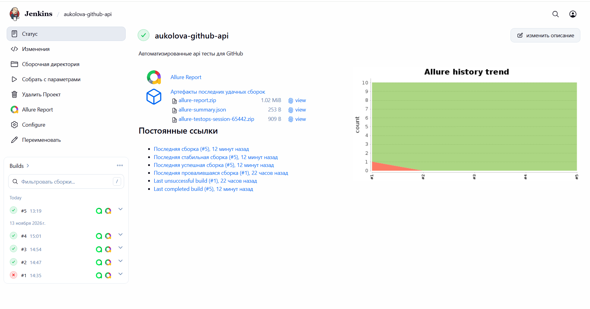
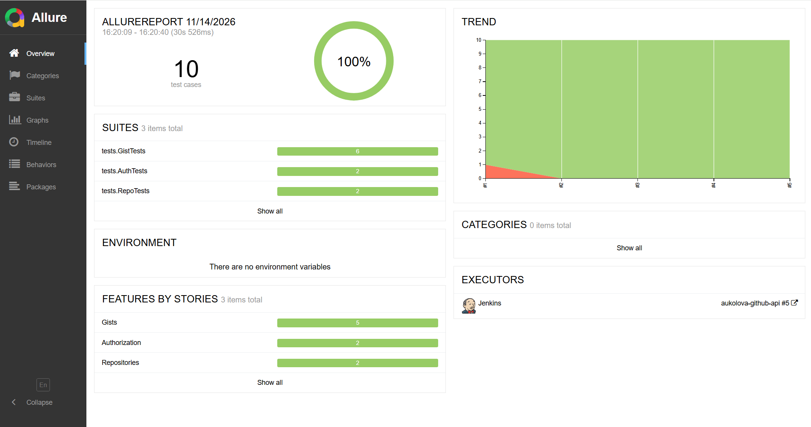
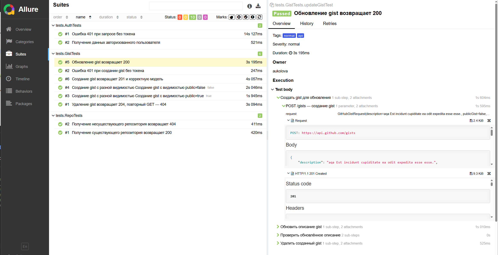
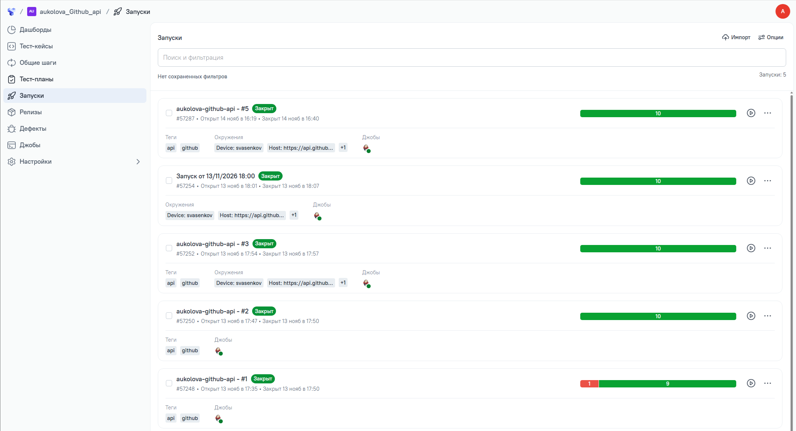
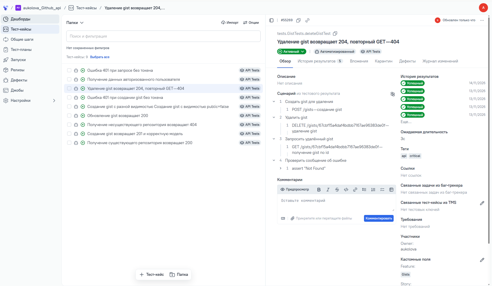
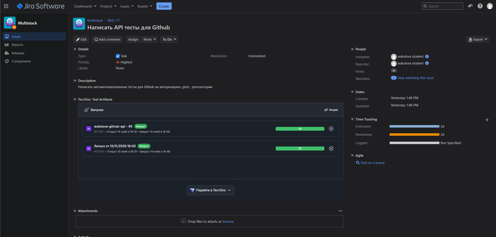
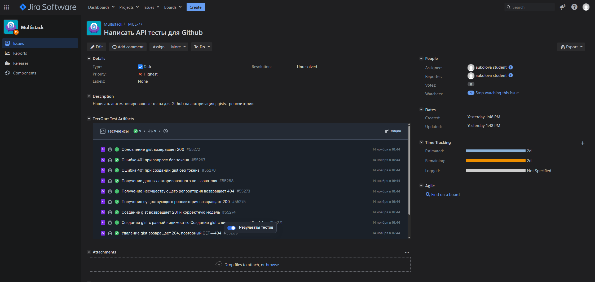
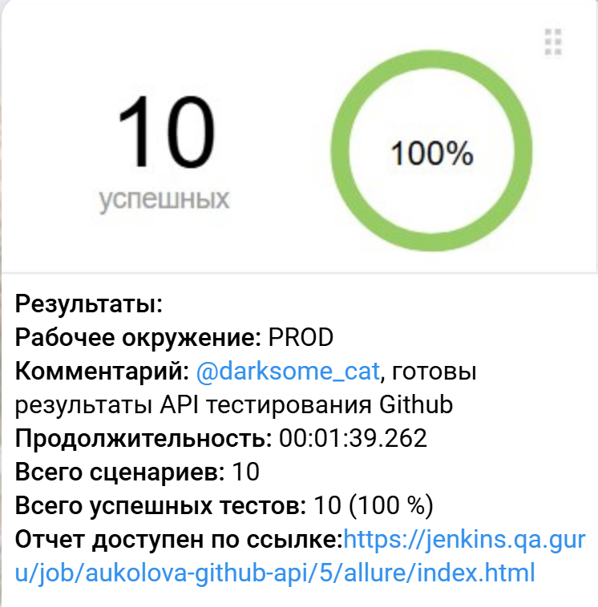

<h1 align="center">Проект по автоматизации тестирования GitHub REST API</h1>
<h2 align="center"><a href="https://github.com">GitHub</a></h2>

<p align="center">
  <a href="https://github.com/" title="GitHub — крупнейший веб-сервис для хостинга IT-проектов">
    
  </a>
</p>

> **GitHub** — крупнейший веб-сервис для хостинга IT-проектов и их совместной разработки.  
> Платформа предоставляет полноценный REST API для управления репозиториями, профилями пользователей, gist и другими сущностями.  
> Документация API: [docs.github.com/rest](https://docs.github.com/rest).


____

## Содержание

* <a href="#tools">Технологии и инструменты</a>
* <a href="#cases">Тест-план автоматизированных тест-кейсов</a>
* <a href="#structure">Структура проекта</a>
* <a href="#console">Запуск тестов из терминала</a>
* <a href="#jenkins">Сборка в Jenkins</a>
* <a href="#allure">Allure-отчёт</a>
* <a href="#allure-testops">Интеграция с Allure TestOps</a>
* <a href="#jira">Интеграция с Jira</a>
* <a href="#telegram">Уведомления в Telegram</a>

____

<a id="tools"></a>
## Технологии и инструменты

<p align="center">
  <a href="https://www.jetbrains.com/idea/"></a>
  <a href="https://www.java.com/"></a>
  <a href="https://gradle.org/"></a>
  <a href="https://junit.org/junit5/"></a>
  <a href="https://rest-assured.io/"></a>
  <a href="https://github.com/allure-framework/allure2"></a>
  <a href="https://qameta.io/"></a>
  <a href="https://www.jenkins.io/"></a>
  <a href="https://www.atlassian.com/software/jira/"></a>
  <a href="https://github.com/"></a>
  <a href="https://web.telegram.org/"></a>
</p>

- Автотесты написаны на **Java** с использованием **REST Assured** и **JUnit 5**.
- Сборка проекта — **Gradle**.
- Модели запросов и ответов — **Lombok** + **Jackson**.
- Конфигурация окружений — **Owner**.
- Генерация тестовых данных — **DataFaker**.
- Валидация ответов — **JSON Schema Validator**.
- CI — **Jenkins** с формированием **Allure Report**.
- Результаты и тест-кейсы — в **Allure TestOps**, интеграция с **Jira**.
- Уведомления о прогоне — в **Telegram** через бота.

Содержание Allure-отчёта:
* шаги теста;
* запросы и ответы API;
* статус-коды и JSON-схемы ответов;
* параметры запуска и окружение.

____

<a id="cases"></a>
## Тест-план автоматизированных тест-кейсов

**Авторизация (`/user`):**
- Получение данных авторизованного пользователя — 200, проверка логина и типа пользователя;
- Запрос без токена — 401, сообщение `Requires authentication`.

**Репозитории (`/repos/{owner}/{repo}`):**
- Получение публичного репозитория — 200, проверка `full_name`, `id` и `default_branch`;
- Получение несуществующего репозитория — 404, тело ошибки со статусом `404`.

**Gists (`/gists`, полный CRUD):**
- Создание gist — 201, проверка JSON-схемы, модели и полей ответа;
- Обновление gist (PATCH) — 200, описание изменилось;
- Удаление gist (DELETE) — 204, повторный GET — 404;
- Создание gist без токена — 401;
- Создание gist с видимостью public=true/false.

____

<a id="structure"></a>
## Структура проекта

```
src/test/java/
├── api/          # API-клиенты: BaseApiClient (константы путей), UserApi, RepoApi, GistApi
├── config/       # ApiConfig — Owner-конфигурация; TokenProvider — чтение GITHUB_TOKEN
├── helpers/      # CustomAllureListener — tpl-шаблоны; GistHelper — подготовка и очистка gist
├── models/       # DTO на Lombok (@Data, @Builder, @JsonProperty для snake_case)
├── specs/        # BaseSpec — baseUri и базовые request/response спецификации
└── tests/        # TestBase (конфигурация), TestData (тестовые данные и константы),
                  # AuthTests, RepoTests, GistTests
src/test/resources/
├── tpl/          # request.ftl, response.ftl — шаблоны Allure
└── schemas/      # JSON-схемы: user_schema, repo_schema, gist_schema, error_schema
```

____

<a id="console"></a>
## Запуск тестов из терминала

### Локальный запуск

```bash
./gradlew clean test
```

### Параметры запуска

| Параметр | Описание |
|---|---|
| `baseUri` | Базовый URI API |
| `githubUser` | Логин GitHub |
| `githubRepo` | Репозиторий для тестов (owner/name) | 
| `githubToken` | Personal Access Token | 

### Токен

Тестам нужен GitHub Personal Access Token (classic) со скоупами `repo` и `gist`.


1. Системное свойство `githubToken`:

```bash
./gradlew test -DgithubToken=ТОКЕН
```

2. Файл `src/test/resources/api.properties` (добавлен в `.gitignore`):

```properties
githubToken=ТОКЕН
```

3. Переменная окружения `GITHUB_TOKEN` — рекомендуемый способ для Jenkins:

```bash
GITHUB_TOKEN=ТОКЕН ./gradlew test
```

Пример запуска с параметрами:

```bash
./gradlew clean test -DgithubToken=ТОКЕН -DgithubRepo=octocat/Hello-World
```

____

<a id="jenkins"></a>
##  <a href="https://jenkins.qa.guru/job/aukolova-github-api">Сборка в Jenkins</a>

Пример шага сборки с параметрами:

```bash
./gradlew clean test \
  -DgithubUser=${USER} \
  -DgithubRepo=${REPO} \
  -DbaseUri=${BASE_URI}
```

<p align="center">
  
</p>

____

<a id="allure"></a>
##  <a href="https://jenkins.qa.guru/job/aukolova-github-api/5/allure/">Allure-отчёт</a>


### Overview

<p align="center">
  
</p>

### Результаты выполнения теста

<p align="center">
  
</p>

____

<a id="allure-testops"></a>
##  <a href="https://allure.qa.guru/project/5437/dashboards/5727">Интеграция с Allure ТестОпс</a>

Выполнена интеграция сборки Jenkins с **Allure TestOps**. Каждый тест размечен аннотациями `@Story`, `@JiraIssues`, `@Tags`, `@Severity` и `@DisplayName`.

### Запуски

<p align="center">
  
</p>

### Тест-кейсы в TestOps

<p align="center">
  
</p>

____

<a id="jira"></a>
##  <a href="https://jira.qa.guru/browse/MUL-77">Интеграция с Jira</a>

Реализована интеграция **Allure TestOps** с **Jira**: в тикете отображаются связанные тест-кейсы и результаты прогонов через аннотации `@JiraIssue`.

### Запуски

<p align="center">
  
</p>

### Тест-кейсы

<p align="center">
  
</p>

____

<a id="telegram"></a>
##  Уведомления в Telegram

После завершения сборки бот в Telegram отправляет сообщение с результатом прогона.

<p align="center">
  
</p>

____
